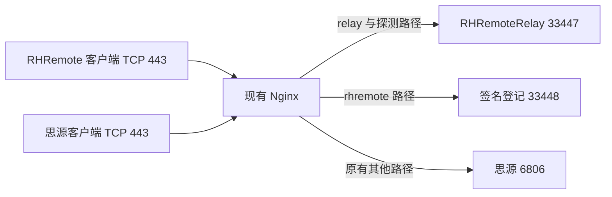

# TCP 443 中继共存方案

2026-10-23，候选、证书同步、安装及回滚实现已完成隔离测试，真实证书只读预检通过。尚未切换生产 443，也未完成受限网络验收。

tc 的 443 由 siyuan-nginx 容器提供，宿主配置 /home/ubuntu/docker/siyuan/siyuan-nginx/conf/nginx.conf 以单文件只读方式挂载。现有根路径和 /ws、/api/ws 转发到思源。独立 RHRemote HTTPS 中继仍工作在 33449，正式公网 IP 证书由独立 Caddy 服务续期。

建议让现有 Nginx 按路径共存，避免移动监听端口或重建思源容器：/relay、兼容 /derp、/ping 和 /generate_204 转发到容器实际网关 172.18.0.1:33447，/rhremote/ 去除前缀后转发到 33448。思源原有根路径、WebSocket 规则和其他代理参数保持原样。47990 管理网页不加入任何中继转发。



中继连接必须保留原始 Upgrade / Connection 头和长连接超时，不能只按普通短 HTTP 请求代理。这依据 [Nginx 的协议升级代理说明](https://nginx.org/en/docs/http/websocket.html)，路径则来自锁定的 iroh-relay 1.4.1 / 1.3.0 源码。候选使用已有的 connection_upgrade 映射，显式关闭代理缓冲。

工具 tools/prepare-relay-443-plan.py 只生成文件，没有应用或重载功能。它核对原配置锚点、单个 443 server、证书引用和 Docker 私网网关，拒绝重复、布局变化及地址注入。候选还在原有套件前补上两个 ECDSA TLS 1.2 套件，原来的 RSA 套件保留；当前新证书是 ECDSA，而思源原配置只有 RSA 套件。移除新增块、恢复证书引用及原套件行后必须与原快照逐字一致。四项生成器回归通过。证书类型与套件的兼容依据见 [Nginx SSL 模块说明](https://nginx.org/en/docs/http/ngx_http_ssl_module.html)。

本机最新候选及 proposed.diff 位于 D:\RHRemoteTools\relay443-plan-20261023\candidate-v2。原配置 SHA256 为 b00451f8da1b9fc7dc15c030260e37f83900367276bab4cc87e9d70b8886bd34，新候选 SHA256 为 3460e7d69e4b578c6ab2cadc5b0057a3ddd7802ff332b4897375c84c4ffe9cdb。早先的 routes-only.nginx.conf 保留旧证书，仅用于语法检查；它已在实际容器的 /etc/nginx 下通过 nginx -t。首次放在 /tmp 时因相对 mime.types 路径不存在而失败，改在正确配置目录验证后通过。整个过程没有重载生产 Nginx；原配置、证书哈希、容器 ID、主进程和重启次数均未变化，容器内访问 RHRemote 后端也已成功。

## 证书与应用前置项

同一个公网 IP 的 443 需要向 RHRemote 提供可信 IP 证书，因此此方案会改变思源客户端在该入口看到的证书。备选方案是使用自有独立域名和 SNI server，保留原默认思源证书；当前没有用户提供的域名，不擅自引入第三方动态域名依赖。

IP 共存候选把旧证书两行替换为 /etc/nginx/ssl/rhremote-443/current.conf 引用，证书和私钥使用同一版本目录。当前 Caddy 公共证书的 PEM SHA256 为 2c78b07a46aa92318df43a1ea31f12a923dab0c681f007480b1db9dcf253a949，到期时间为 2026-10-29 19:38:49 UTC；申请者私钥仍留在 tc，未复制到本机或仓库。本轮未把该证书接入思源容器。

tools/relay_nginx_cert.py 在 tc 本机核对证书链、IP、密钥匹配、来源账户和私钥权限，要求至少还有一天有效期。证书及私钥进入同一不可变版本目录（目录 0700、文件 0600），再原子替换 include；实际容器 nginx -t 和 TLS 1.2 / 1.3 握手验证均通过后才记录成功状态。未换证书时不重复重载。失败恢复旧 include 和真实监听证书，并保留上一次状态；并发编辑则停止，保留他人的内容供检查。私钥仅在 tc 处理，不写日志、返回值或仓库。证书校验使用 [OpenSSL 的证书验证选项](https://docs.openssl.org/3.0/man1/openssl-verification-options/)。

tools/deploy_relay_nginx443.py 默认只读，只有显式 --mode apply 才会安装。它固定核对容器 ID、只读挂载源、原配置和候选哈希，备份原配置，保留单文件挂载的 inode 原地写入，并核对容器实际读取内容。不能只替换宿主路径后假定挂载已更新，参见 [Docker 挂载说明](https://docs.docker.com/engine/storage/bind-mounts/)。首次证书同步成功后才安装 rhremote-nginx-cert-sync.service / .timer，每小时检查 Caddy 续期结果；定时器启动失败也回滚初始安装。

服务代码位于 /usr/local/lib/rhremote-nginx443，配置位于 /etc/rhremote-nginx443/config.json，私有状态位于 /var/lib/rhremote-nginx443。systemd 以 root 访问本机 Docker 和 Caddy 私钥，文件系统只允许写入自身状态及托管证书子目录，/home 保持只读。Caddy 仍负责 ACME 申请和续期；此服务只同步已有有效证书。配置或容器发生变化时哈希校验会拒绝运行，需要重新审核部署参数，不能静默覆盖运营修改。

已完成的验证：

- 15 项 Linux/OpenSSL 同步回归：不匹配密钥、错误 IP / CA、临近过期、权限、符号链接、并发修改、重载和落盘失败、回滚及不重复重载。
- 9 项安装回归：只读模式、保留挂载 inode、写入中断恢复、Nginx 检查失败、定时器启动失败、显式回滚、保留运营修改及 systemd 参数注入拒绝。
- tc 上使用已缓存的同版 Nginx 镜像，启动仅监听回环地址的独立临时容器，使用生成的测试 CA / RSA / ECDSA 密钥。真实复现 RSA 套件配 ECDSA 证书的 TLS 1.2 失败并恢复旧证书；加入兼容套件后 TLS 1.2 / 1.3 均通过。真实安装及显式回滚保留 inode；证书轮换期间已建立的 Upgrade 连接继续传输 1 MiB，内容哈希一致。生产思源配置、证书、容器 ID、主进程和重启次数前后相同，测试容器已移除。
- 实测发现 Nginx 异步重载时连续排队的重载可能短暂命中不同 worker 代际，不能凭一次成功握手提交状态。现在要求两种 TLS 版本在连续一秒窗口中均匹配预期证书，失败重置窗口；回归覆盖这次竞争问题。
- systemd 单元通过 tc 的 systemd-analyze verify；隔离安装测试的定时器启停使用替身，没有声称真实系统单元已经安装或运行。
- 使用真实 Caddy 证书 / 密钥执行默认只读预检，通过 CA / IP / 密钥、容器绑定及候选哈希校验。输出明确 privateKeysCopied=false、reloaded=false、productionChanged=false，未向思源证书目录复制真实密钥。

结果日志位于 D:\RHRemoteTools\test-relay-nginx-cert-integration-20261023-r4.log（包含 15 + 9 项最终回归及实际容器测试）和 relay443-real-material-dryrun-20261023.log。GitHub 的 relay-443-tools.yml 持续运行这 28 项 Python 回归；隔离 Docker 测试仍需在 tc 显式运行，不在 CI 访问生产环境。只读预检包在 tc 的 /tmp/rhremote443-review-20261023-v2，root 所有；生产操作前须重新核对当前源码、配置哈希、容器及证书有效期。

完成证书影响的最终确认后，部署命令如下；未获得确认前不要运行 apply：

```sh
sudo python3 -B /tmp/rhremote443-review-20261023-v2/deploy_relay_nginx443.py \
  --config /tmp/rhremote443-review-20261023-v2/settings.json \
  --candidate /tmp/rhremote443-review-20261023-v2/https-443.nginx.conf --mode apply
```

已完成的安装可显式恢复原思源配置与证书；证书版本、安装代码和私有诊断保留，停止定时器且移除本次安装的单元。回滚拒绝覆盖已改变的配置、include 或单元；进程被强制终止、断电或外部并发修改导致的未完成事务需按 install.json 现场检查，不承诺这些情形自动恢复。

```sh
sudo python3 -B /usr/local/lib/rhremote-nginx443/deploy_relay_nginx443.py \
  --config /etc/rhremote-nginx443/config.json --mode rollback
```

应用时先核对原快照和容器身份、留存回滚文件，候选语法通过后使用 [Nginx 的平滑重载机制](https://nginx.org/en/docs/control.html)，再验证正式证书链、思源 HTTP / WebSocket、RHRemote 实际媒体和签名登记；业务失败时回滚。不把语法通过当成 TLS 或业务验收。

证书切换影响的最终确认、真实 systemd 定时运行、生产部署和真实仅 TCP443 网络测试仍未完成。33449 的成功、隔离容器测试或 Nginx 语法检查均不能替代这些门槛。
