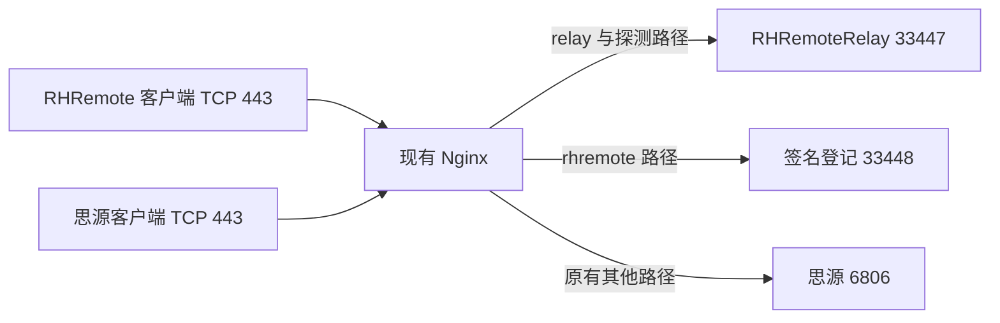

# TCP 443 中继共存方案

2026-10-23，已生成候选并验证路由配置语法，尚未部署或完成受限网络验收。

tc 的 443 由 siyuan-nginx 容器提供，宿主配置 /home/ubuntu/docker/siyuan/siyuan-nginx/conf/nginx.conf 以单文件只读方式挂载。现有根路径和 /ws、/api/ws 转发到思源。独立 RHRemote HTTPS 中继仍工作在 33449，正式公网 IP 证书由独立 Caddy 服务续期。

建议让现有 Nginx 按路径共存，避免移动监听端口或重建思源容器：/relay、兼容 /derp、/ping 和 /generate_204 转发到容器实际网关 172.18.0.1:33447，/rhremote/ 去除前缀后转发到 33448。思源原有根路径、WebSocket 规则和其他代理参数保持原样。47990 管理网页不加入任何中继转发。

中继连接必须保留原始 Upgrade / Connection 头和长连接超时，不能只按普通短 HTTP 请求代理。这依据 [Nginx 的协议升级代理说明](https://nginx.org/en/docs/http/websocket.html)，路径则来自锁定的 iroh-relay 1.4.1 / 1.3.0 源码。候选使用已有的 connection_upgrade 映射，显式关闭代理缓冲。

工具 tools/prepare-relay-443-plan.py 只生成文件，没有应用或重载功能。它核对原配置锚点、单个 443 server、证书引用和 Docker 私网网关，拒绝重复、布局变化及地址注入；移除新增块并恢复证书引用后必须与原快照逐字一致。三项生成器回归通过。

本机候选及 proposed.diff 位于 D:\RHRemoteTools\relay443-plan-20261023\candidate。原配置 SHA256 为 b00451f8da1b9fc7dc15c030260e37f83900367276bab4cc87e9d70b8886bd34。routes-only.nginx.conf 保留旧证书，仅用于语法检查；它已在实际容器的 /etc/nginx 下通过 nginx -t。首次放在 /tmp 时因相对 mime.types 路径不存在而失败，改在正确配置目录验证后通过。整个过程没有重载生产 Nginx；原配置、证书哈希、容器 ID、主进程和重启次数均未变化，容器内访问 RHRemote 后端也已成功。

## 证书与应用前置项

同一个公网 IP 的 443 需要向 RHRemote 提供可信 IP 证书，因此此方案会改变思源客户端在该入口看到的证书。备选方案是使用自有独立域名和 SNI server，保留原默认思源证书；当前没有用户提供的域名，不擅自引入第三方动态域名依赖。

IP 共存候选把旧证书两行替换为 /etc/nginx/ssl/rhremote-443/current.conf 引用，证书和私钥使用同一版本目录。当前 Caddy 公共证书的 PEM SHA256 为 2c78b07a46aa92318df43a1ea31f12a923dab0c681f007480b1db9dcf253a949，到期时间为 2026-10-29 19:38:49 UTC；申请者私钥仍留在 tc，未复制到本机或仓库。本轮未把该证书接入思源容器。

部署前仍需实现并验证自动证书同步：在 tc 本机验证证书、IP 和对应私钥，将一对文件安装到受控的版本目录，原子更新 include，执行实际容器 nginx -t 后再平滑重载；失败恢复原 include。配置为单文件挂载，必须核对容器实际读取的内容，不能只替换宿主路径后假定它已更新。[Docker 的挂载说明](https://docs.docker.com/engine/storage/bind-mounts/)说明宿主文件会直接映射进容器，当前挂载关系来自实际 inspect。

应用时还需核对原快照和容器身份、留存回滚文件，并在服务内验证思源 HTTP / WebSocket、正式证书链、RHRemote 实际媒体和签名登记。只在这些检查通过后使用 [Nginx 的平滑重载机制](https://nginx.org/en/docs/control.html)，不把语法通过当成 TLS 或业务验收。

自动续期同步、证书切换影响的最终确认、生产部署和真实仅 TCP443 网络测试仍未完成。33449 的成功或本轮 Nginx 语法检查均不能替代这些门槛。
